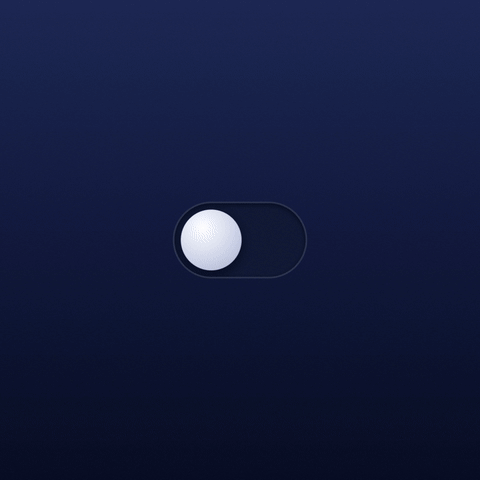
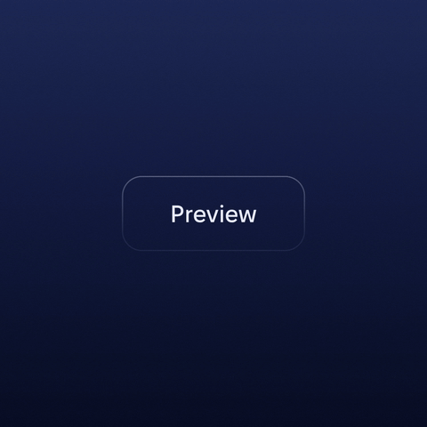
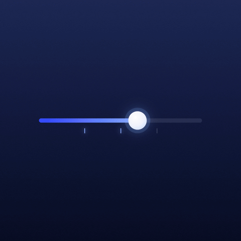
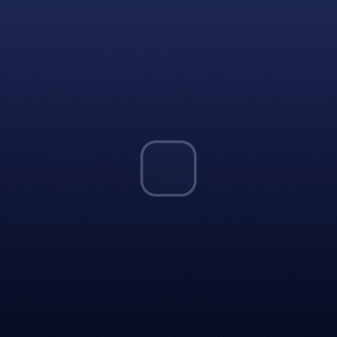

# Spellwork

Four interface components with gentle fairy-dust light, drawn in WebGL with Three.js: a toggle, a ghost button, a slider and a checkbox.

| Toggle | Ghost button |
| --- | --- |
|  |  |
| **Slider** | **Checkbox** |
|  |  |

- **Toggle:** hold to light a crown of stars, release and a comet arcs over the track as the knob glides across.
- **Ghost button:** a sprite floats round it on hover; on press it loops the outline, rises and bursts into falling stars.
- **Slider:** the thumb leaves stardust; a star pops at each quarter.
- **Checkbox:** a comet curls in and seals it; clearing it lets the light lift out like fireflies.

The controls are real HTML elements (button with `role="switch"`, `input type="range"`, `input type="checkbox"`), so keyboard and screen readers work. One fixed WebGL canvas draws all the light on top and the loop sleeps when nothing is glowing. Reduced-motion settings shorten the effects. Three themes: Arcane, Fire, Emerald.

## Run

Open `index.html` in a browser. Three.js r128 loads from cdnjs; the Fixel fonts are embedded in the page.

## Media

`media/` holds four 1080×1080, 60 fps MP4 loops, one per component. `media/gif/` has 480 px GIF versions of the same loops.

## License

Code: MIT, see `LICENSE`.

Fonts: Fixel by MacPaw, under the SIL Open Font License 1.1, see `FIXEL-OFL.txt`.
